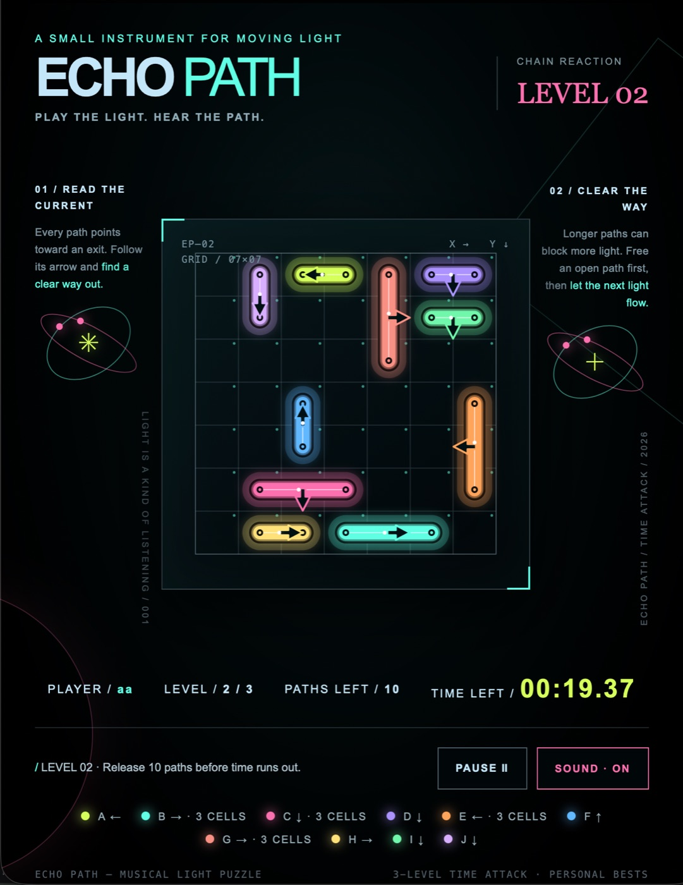
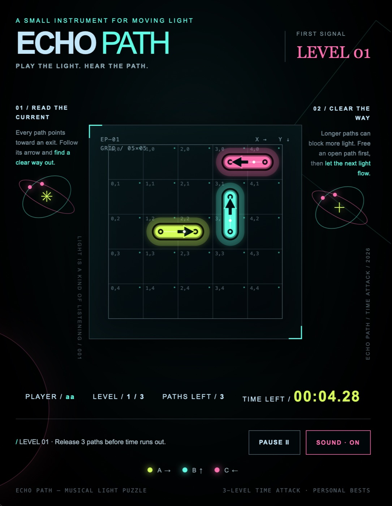
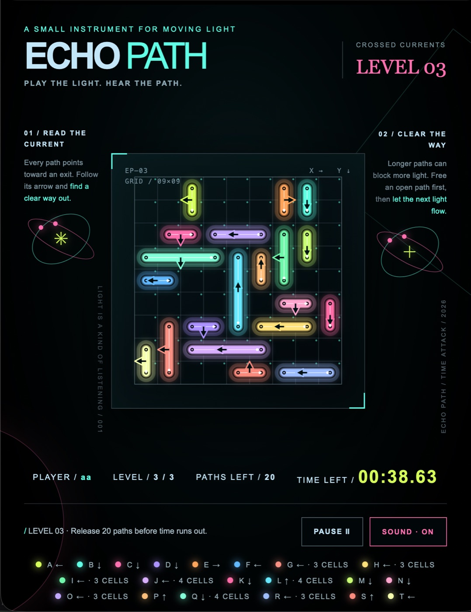
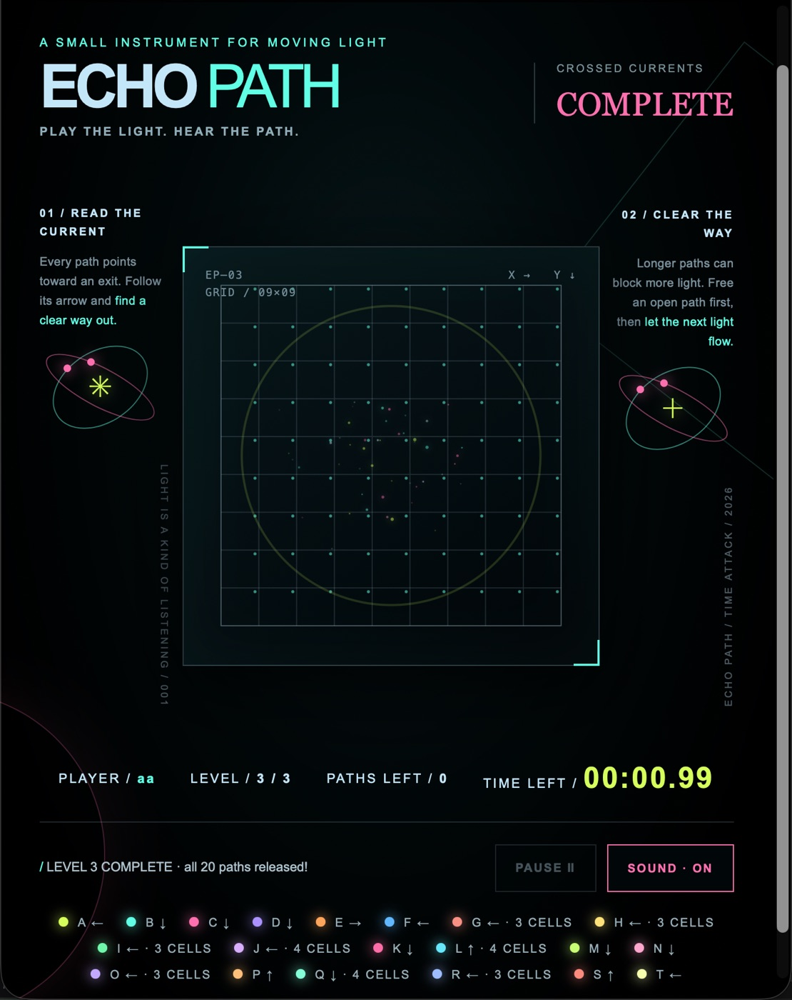
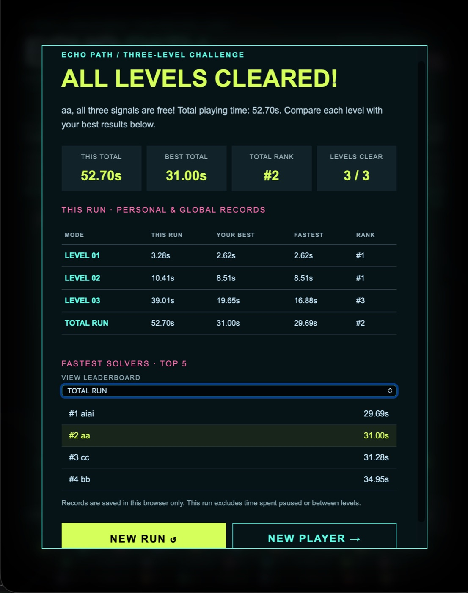

# ECHO PATH — Play the Light. Hear the Path.

**A Three-Level Musical Light-Path Puzzle Game**

SD5913 · Assignment 3: An Interactive Experience (2026)

**[▶ Play ECHO PATH Online](https://vivienhh.github.io/echo-path/)** · [Development Process](PROCESS.md)


---


<!-- ECHO_PATH_SCREENSHOTS_V1 -->



*ECHO PATH — Final gameplay showing luminous paths, movement arrows and collision-based puzzles.*

## 1. Project Overview

ECHO PATH is a small browser-based puzzle game that combines spatial problem-solving, glowing visual effects, and interactive sound.

Players need to release interconnected light paths from a grid by identifying which paths can move without being blocked by others. Each successful action produces animated light trails and musical feedback.

The game includes three levels with increasing complexity, creating a short but progressively challenging experience.

### Design Goal

The central design goal is to create an intuitive and satisfying interaction loop:

**Input → Response → Feedback**

- **Input:** The player clicks a glowing light path.
- **Response:** The program checks whether the selected path can move in its indicated direction.
- **Feedback:** A valid path leaves the board with animation and sound. A blocked path remains in place and produces feedback.

The player uses this feedback to understand the puzzle and decide what to do next.

### Intended Users

ECHO PATH is designed for casual players who enjoy short logic puzzles, visual challenges, and playful interactive experiences.

No previous experience with coding or complex games is required.

---

## 2. How to Play

1. Enter a player nickname and click **START CHALLENGE**.
2. Observe the glowing paths on the board. Each path has an arrow indicating its movement direction.
3. Click a path to release it in the direction of its arrow.
4. If another path blocks its exit, remove the blocking path first.
5. Release all paths before the countdown reaches zero.
6. Complete all three levels to see your results and leaderboard rankings.

### Game Levels

| Level | Board Size | Number of Paths | Time Limit |
| --- | --- | --- | --- |
| Level 01 — First Signal | 5 × 5 | 3 | 10 seconds |
| Level 02 — Chain Reaction | 7 × 7 | 10 | 20 seconds |
| Level 03 — Crossed Currents | 9 × 9 | 20 | 40 seconds |

The three levels gradually introduce more paths and more complicated spatial relationships.

### Additional Controls

- **PAUSE:** Pause the current challenge.
- **RESUME:** Continue the paused challenge.
- **RESTART FULL RUN:** Restart the three-level experience.
- **EXIT TO MENU:** Leave the current run.
- **SOUND ON/OFF:** Enable or disable game audio.

---


### Gameplay Gallery

**Welcome and Player Entry**



**Level 03 — Crossed Currents**



**Completion Animation**



**Final Results and Leaderboard**



*These screenshots show the final version after visual refinement and user-feedback-driven changes.*

---

## 3. Run the Project

### Option A — Play Online

The game is available on GitHub Pages:

https://vivienhh.github.io/echo-path/

Open this link in a modern desktop browser.

No installation, account, paid service, or API key is required.

Browser audio is activated through user interaction when starting the game.

### Option B — Run Locally

**Requirements:**

- A modern web browser
- Python 3
- Git, if cloning the repository

Clone the public repository:

```bash
git clone https://github.com/vivienhh/echo-path.git
cd echo-path
```

Start a local web server:

```bash
python3 -m http.server 8000
```

Open the following address in your browser:

http://localhost:8000/

Press `Ctrl+C` in the terminal to stop the server.

### Technologies

The project uses:

- HTML
- CSS
- JavaScript
- HTML Canvas 2D
- Web Audio API
- Browser localStorage

The main playable version is located in the root `index.html` file.

No npm packages, Python dependencies, external AI models, or API credentials are required to run the game.

---

## 4. Interaction and Feedback

ECHO PATH emphasizes the relationship between player actions and immediate system responses.

### Valid Path Release

When the player selects an unobstructed path:

- The path moves in its indicated direction.
- Animated particles and glowing light trails appear.
- A musical sound confirms the action.
- The remaining-path count updates.

### Blocked Path

When another path blocks the selected path:

- The selected path stays in place.
- The game provides blocked-action feedback.
- The player can reconsider the order of path releases.

### Level Completion

When all paths are successfully released:

- A celebratory visual effect appears.
- A completion sound plays.
- The game progresses to the next level or displays the final results.

### Mistakes and Interruptions

The game also handles several common situations:

- An empty player nickname is not accepted.
- Blocked paths cannot leave the board.
- The player can pause and resume the countdown.
- The player can restart or exit a run.
- Sound can be disabled without removing visual gameplay feedback.

These features help players understand what happened and recover from interruptions.

---

## 5. Visual and Audio Design

### Visual Direction

ECHO PATH uses a dark interface with bright neon colors to emphasize the moving paths.

Its visual palette includes:

- Lime green: `#D5FF5A`
- Mint cyan: `#60FFE5`
- Pink: `#FC70AF`
- Ice blue: `#C4E6F9`

Glowing particles, moving light trails, and subtle decorative elements create a futuristic and playful atmosphere.

### Audio Direction

The audio design combines musical interaction feedback with a gentle cosmic background atmosphere.

Each level includes a different background music variation:

- **Level 01 — Stargazer:** A quiet and atmospheric introduction.
- **Level 02 — Orbit Drift:** A more playful and gently rhythmic atmosphere.
- **Level 03 — Nebula Rush:** A slightly faster and more energetic sound environment.

Path-release and level-completion sounds are designed to be more prominent than the background music.

The musical feedback helps communicate successful actions while supporting the overall atmosphere.

---

## 6. User Testing and Iteration

### External Playtest — 30 October 2026

One friend independently tried ECHO PATH and shared feedback through a text conversation.

The participant had some previous experience with similar puzzle-game mechanics.

### Positive Feedback

The participant responded positively to:

- The visual presentation
- The puzzle interaction mechanics
- The click sound effects
- The overall game experience

### Identified Usability Issue

The participant reported that the first-level countdown ended while they were still reading the interface instructions and trying to understand the game.

The original five-second limit did not leave enough time for this participant to orient themselves.

The participant suggested increasing the introductory limit by approximately five seconds.

### Design Decision

Based on the feedback, I selected a ten-second limit as a more suitable target for the introductory level.

I attempted to implement this change while keeping the other levels at 20 and 40 seconds.

The revised ten-second countdown is now present in the published game and has been checked during gameplay. Further external testing is needed to evaluate whether the new limit improves first-time usability.

### Reflection

This testing experience showed that my familiarity with the puzzle may have caused me to underestimate how much time a first-time player needs to understand the interface.

An introductory level should support orientation and learning before emphasizing speed.

This informal test involved only one participant, so the proposed ten-second limit still requires further evaluation.

Additional design decisions, implementation changes, and testing notes are documented in [PROCESS.md](PROCESS.md).

---

### External Playtest — 31 October 2026

Three additional friends tried ECHO PATH.

One participant found the combination of letters and arrows on the puzzle paths confusing. Two others felt that the original five-second opening countdown was too short.

The participants responded positively to the visual design, gameplay mechanics, difficulty, and overall enjoyment.

Based on this feedback, I removed the visible path letters while preserving the directional arrows and implemented a ten-second introductory limit.

The changes have been checked by the developer in the published game. A new independent playtest is still needed to evaluate their effectiveness.

---
## 7. Development Process

The project was developed through several iterations:

1. Defined the initial light-path puzzle concept.
2. Implemented clickable paths and collision detection.
3. Added clearer feedback and restart controls.
4. Developed a more polished visual prototype.
5. Expanded the experience into three progressively challenging levels.
6. Added player names, results, and locally saved leaderboards.
7. Improved moving particles and completion animations.
8. Integrated interactive sound effects and background music.
9. Adjusted audio balance through self-testing.
10. Collected external playtest feedback and reconsidered the introductory time limit.

The Git commit history and `PROCESS.md` document the development process.

---

## 8. Project Structure

| File / Folder | Description |
| --- | --- |
| `index.html` | Main playable three-level game and GitHub Pages entry point |
| `visual-prototype/echo-path-prototype.html` | Integrated visual and gameplay prototype |
| `game.js` | Earlier development prototype |
| `PROCESS.md` | Design decisions, development history, testing, and AI usage |
| `README.md` | Project documentation and running instructions |
| `assets/echo-path-gameplay.png` | Gameplay screenshot |

---

## 9. Known Limitations

- Leaderboard records are stored locally in each browser using localStorage. They are not shared between devices.
- The introductory level now has a ten-second limit. Follow-up testing with unfamiliar players would help evaluate this change.
- Four participants provided informal feedback across two playtest rounds. The revised interface has not yet been independently retested.
- Further testing with unfamiliar players and different devices would help evaluate usability.
- Audio playback depends on browser support and user interaction.

---

## 10. Credits and AI Tool Use

### Project Design and Development

**Yichen Huang (Vivien)**

Concept development, interaction design, visual direction, testing decisions, iteration, and final project curation.

### AI-Assisted Development

**ChatGPT (OpenAI)**

Used to assist with:

- Exploring interaction concepts
- Planning gameplay logic
- Generating and revising HTML, CSS, and JavaScript
- Debugging collision, timing, and audio behavior
- Improving animation and interaction feedback
- Preparing development documentation

Generated suggestions were reviewed and revised through implementation and testing.

**Easel Studio**

Used to explore visual design directions and prototype interactive sound.

Selected visual elements and audio ideas were adapted into the final browser game.

### External Materials and Dependencies

The project uses standard browser technologies, including Canvas 2D and the Web Audio API.

The playable version does not require external commercial music recordings or paid services.

The project was created for educational purposes as an individual assignment for SD5913.

---

## 11. Live Project

**Play the game:**

https://vivienhh.github.io/echo-path/

**GitHub repository:**

https://github.com/vivienhh/echo-path

**Development documentation:**

[PROCESS.md](PROCESS.md)
